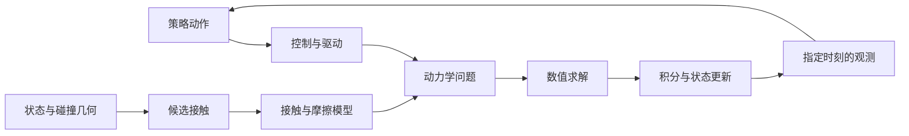

# 1 · 从策略动作到接触响应：仿真一步发生什么

[教程目录](README.md) · [下一篇样章：外层与内层](05-nonlinear-and-linear.md) · [版本与来源](source-versions.md)

**先修：** 知道机器人状态、动作和矩阵乘法的含义。**读完目标：** 面对物体滑落或穿透，能把可能原因定位到输入、模型、求解、时间更新或观测层，并提出下一步证据检查。

**教材衔接：** 先读 [Physics-Based Simulation 第 1–2 章](../physics-based-simulation.md)，再用本章区分机器人动作、驱动和物理响应；第 4 章的小型实现帮助追踪完整一步。

## 从一个常见误判开始

策略给出“夹紧”，画面中的手指也闭合了，物体却下落。此时直接把摩擦系数调大，可能碰巧改善轨迹，但尚未解释原问题：动作是否经过缩放？位置目标对应的驱动力是否饱和？手指真正接触的是哪块碰撞几何？记录的“力”究竟是控制输入还是接触反力？

先把一次步进画成一张职责图。它是阅读地图，不规定六个引擎使用完全相同的调用顺序；隐式方法可能在一次时间步内多次装配力和导数。



| 层次 | 它回答的问题 | 先看什么 |
|---|---|---|
| 策略与控制 | 命令怎样变成实际输入？ | action scale、目标/力矩语义、控制周期、饱和 |
| 几何与接触生成 | 哪些表面可能相互作用？ | 碰撞形状、变换、距离、过滤、采样 |
| 接触与摩擦模型 | 相互作用满足什么关系？ | 法向柔顺性、摩擦表示、材料组合、近似 |
| 动力学与约束 | 哪些未知量必须一起确定？ | 质量/惯量、关节约束、力或冲量、状态 |
| 求解方法 | 怎样近似满足该数学问题？ | 迭代、残差、停止原因、实际算法分支 |
| 积分 | 怎样从当前状态推进时间？ | 物理步长、离散方法、内部 stage/子步 |
| 观测 | 输出描述哪个时刻的什么量？ | 力/冲量、坐标、采样阶段、缓存有效性 |

## 最小动力学地图

只看刚体的广义速度，连续动力学可写作

```math
M(q)\dot v+c(q,v)=\tau+J(q)^T f.
```

这里 $`q`$ 是配置，$`v`$ 是广义速度；$`M`$ 是质量/惯量矩阵；$`c`$ 含所选约定下的重力与速度偏置；$`\tau`$ 是其他广义输入；$`f`$ 是约束空间的力，$`J`$ 把广义速度映射到相应约束速度。平移力分量单位为 N、关节力矩为 N·m，不能把不同量纲的分量直接当成同一种“力”。

$`J^T f`$ 表示接触会通过机构影响多个关节。已知策略输出并不等于已知 $`f`$。如果采用离散冲量形式，未知量可能是 $`p\approx h f`$，其单位是 N·s；只有明确离散约定和时长后才能转换。上式提供概念坐标，具体引擎可能采用不同状态、约束或变分形式。[MuJoCo 的固定源码说明](https://github.com/google-deepmind/mujoco/blob/9ea3cdfcae93bf2cc4dc0e1a1627c5a39a1e06e5/doc/computation/index.rst#L217-L240)给出一个原生对应。

对一维平移的简单半隐式更新，可以用

```math
v_{n+1}=v_n+h a_n,\qquad x_{n+1}=x_n+h v_{n+1}
```

理解“求运动变化”和“推进时间”的区别。这是教学离散式，不是所有引擎名为 Euler 的选项的完整实现；MuJoCo Euler 还可包含阻尼的隐式处理。四元数姿态必须使用相应流形更新，不能照搬标量加法。对应实现继续读[MuJoCo 求解与积分](https://github.com/huangkiki/mujoco-learning/blob/main/docs/solvers-and-integration.md)。

## 同一场景中的三个时钟

假设策略每 20 ms 给出一个动作，物理步长是 2 ms，显示器每秒刷新 60 次。这是教学配置，尚未运行任何引擎。

- 若每个动作保持 10 个物理步，则控制频率为 50 Hz，物理频率为 500 Hz。
- 每个物理步内部的 20 次 solver 迭代不把仿真时间推进 20 次；它们是在求同一步的未知量。
- 显示 60 FPS 不证明物理只跑了 60 Hz，也不证明系统实时；wall-clock 成本还受记录、渲染和同步影响。

如果把物理步长减为 1 ms 而动作仍保持 10 步，控制周期就变成 10 ms。你同时改变了积分离散和控制时序，不能把策略效果变化全部归因于更小步长。保持 20 ms 控制周期需要相应核对动作保持逻辑，而不是只改一个 XML/配置字段。

## 怎样读一条配置

以 `MuJoCo / Newton / elliptic / implicitfast` 为例：

| 名称 | 解释 |
|---|---|
| MuJoCo | 物理引擎；继续记录核心版本与实际运行路径 |
| Newton | 此处用于约束问题的求解方法 |
| elliptic | 接触摩擦锥的表示；不是第二个求解器 |
| implicitfast | 时间积分选项；不是增加 Newton 迭代 |

这仍不是完整可复现配置。至少还需模型、质量/惯量、接触参数、时间步长、控制、solver 预算/容差与有效观测。不同版本的同名设置也应分别核对。

再看 `Newton Physics / Kamino / PADMM`：第一项是项目，第二项是系统实现，第三项是动力学求解后端。不能因为都出现 Newton，就认为它和上面的 Newton 约束方法是同一个比较对象。[DexLab 角色说明](https://github.com/huangkiki/Dexlab/blob/7e4a0774efb4f8b332e866e1495e032b4969c8aa/docs/solver-taxonomy.zh-CN.md)保留了这些层次。

## 诊断：夹持滑落，先收集哪些证据

先声明物理参照和任务条件，再逐层核对。下表不声称有一个适用于所有引擎的固定调参顺序。

| 假设 | 能检验它的观测 | 仅凭什么还不能确认 |
|---|---|---|
| 驱动不足或提前饱和 | 实际目标、输入/输出、限幅、闭合时刻 | “策略发了夹紧动作” |
| 碰撞输入有误 | 有效碰撞几何、坐标、过滤和接触对象身份 | 渲染 mesh 看起来接触 |
| 摩擦或接触模型不适用 | 有效材料参数、法向载荷、切向运动与模型假设 | μ 的配置数字相同 |
| 当前数值问题没有充分求解 | 停止原因、残差定义、迭代变化与其他条件固定的对照 | 单次失败或迭代次数小 |
| 观测陈旧或语义错误 | 采样阶段、frame、量纲、缓存刷新、对象归属 | 日志字段名中含 force |

数值残差变小，说明某个已定义数学问题求得更充分；它仍可能对应错误几何、错误参数或不合适的物理模型。任务成功也只是指定策略和成功判据下的结果。

## 练习与答案

**配置题：** 把 `implicitfast` 改成 `Euler`，其余字段未动，可以称为“换了约束 solver”吗？

<details><summary>答案</summary>

不可以。它改变时间离散；约束 solver 字段仍需单独查看。积分变化可能影响求解问题和轨迹，但名称所属角色不同。实际兼容性与生效字段需按版本核对。

</details>

**诊断题：** 日志中关节驱动力为 0.8 N，能直接把它当成每个指面法向接触力，代入 $`2\mu N\ge mg`$ 判断夹持必定成功吗？

<details><summary>答案</summary>

不能。先确认输入是平移关节力还是转动关节力矩，检查传动、几何、惯性和接触反力读回。$`2\mu N\ge mg`$ 仅是双面对称、准静态、理想库仑摩擦等假设下的必要支撑能力判断，不能处理任意姿态、加速度和扭转滑移，更不能把控制输入直接当作接触 $`N`$。

</details>

**时间题：** 20 ms 控制周期、2 ms 物理步长改为 1 ms，怎样让“只改物理离散”的对照更接近成立？

<details><summary>答案</summary>

将动作保持从 10 步调整为 20 步，核对控制器内部更新、终止判据、观测采样和总模拟时长。即使控制周期保持，接触发生相位和数值结果仍会改变；记录这些变化，不能承诺轨迹相同。

</details>

## 深入阅读与 English summary

[MuJoCo 动力学流水线](https://github.com/huangkiki/mujoco-learning/blob/main/docs/dynamics-and-pipeline.md) · [Genesis 接触到力观测](https://github.com/huangkiki/genesis-learning/blob/main/docs/contact-solvers-forces.md) · [Robot Learning 生命周期](https://github.com/huangkiki/robot-learning/blob/main/comparisons/lifecycle.md)

A policy action, actuator output and contact reaction are different quantities. Separate geometry, physical contact laws, numerical solving, integration and observation timing before attributing a failure to a solver. The numerical examples here are constructed teaching cases. This lesson provides source-based interpretation and static review, not newly executed physical validation.
