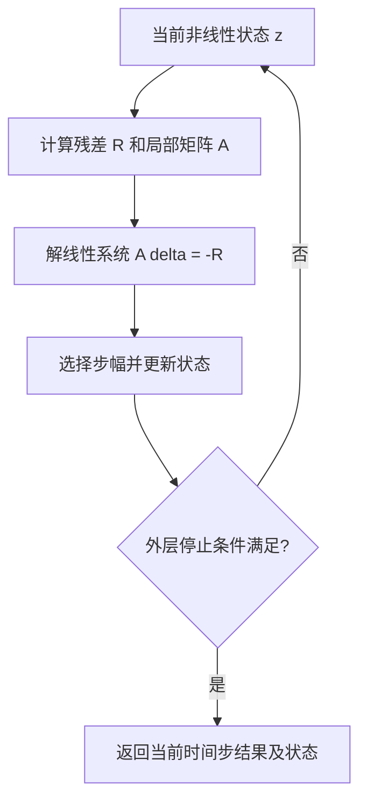

# 5 · Newton 和 GMRES 为什么能同时出现

[教程目录](README.md) · [仿真一步](01-simulation-step.md) · [版本与来源](source-versions.md)

**先修：** 矩阵乘法、导数与[仿真一步](01-simulation-step.md)。**读完目标：** 区分非线性问题、线性子问题、内外层容差，以及同名 CG 在不同引擎中的角色。

**教材衔接：** 先读 [Physics-Based Simulation 第 3 章及第 37 章](../physics-based-simulation.md)，再比较本章的外层/内层与引擎特有分支。

## 先确定“正在解什么”

隐式动力学中的力依赖未知的下一步状态，例如接触位置改变后，接触力和摩擦方向也变了。求解器可能需要找到非线性方程 $`R(z)=0`$ 的解。这里 $`z`$ 是某个状态或局部增量，$`R`$ 是该离散问题的残差；并非每个引擎都采用相同变量或相同 $`R`$。

Newton 方法在当前猜测 $`z_k`$ 附近做线性化：

```math
J_R(z_k)\,\Delta z_k=-R(z_k),\qquad z_{k+1}=z_k+\alpha_k\Delta z_k.
```

外层负责更新非线性状态和重新评估残差。里面那条矩阵方程如何求解，可以使用直接分解，也可以使用线性迭代。因此 `Newton / GMRES` 能表示“外层 Newton、内层 GMRES”，不是二选一。

若求解的是可微目标 $`\Phi(z)`$ 的驻点，则 $`R=\nabla\Phi`$，$`J_R=\nabla^2\Phi`$。一般残差问题未必来自某个标量能量，也未必有对称正定 Jacobian；不能看到 Newton 就自动推出“凸能量最小化”。$`\alpha_k`$ 是增量比例，不是物理时间步长。



## 纸面例子：两种迭代层次

求 $`R(z)=z^2-2=0`$，从 $`z_0=1`$ 出发：第一次线性问题为 $`2\Delta z=1`$，得到 $`z_1=1.5`$；第二次为 $`3\Delta z=-0.25`$，得到 $`z_2\approx1.4167`$。每次线性问题都准确求解，外层非线性残差仍需逐次减小。这是数学算例，没有调用物理引擎。

在高维问题中，内层可能只近似满足 $`A\Delta z=b`$。它的线性残差 $`r=b-A\Delta z`$ 与重新更新状态后的非线性残差 $`R(z_{k+1})`$ 是两个量；前者小不保证后者已经达标，也不保证物理模型准确。

## 同一个 CG 名称的两种含义

| 对象 | 求解问题 | 需要核对的内容 |
|---|---|---|
| 线性共轭梯度 Linear CG | 标准形式为对称正定 $`Ax=b`$ | 对称性、正定性、预条件器、线性残差与停止条件 |
| 非线性共轭梯度 Nonlinear CG | 迭代降低非线性目标 $`\Phi(z)`$ | 梯度、搜索方向更新、线搜索、非线性终止条件 |

MuJoCo 配置表中的 CG 是非线性约束优化方法；SuperDex 表中的 CG 是线性子求解选项。它们不能以“都叫 CG”为理由放在一列做纯算法归因。MuJoCo 的具体变量、目标和方向更新见[固定求解器源码](https://github.com/google-deepmind/mujoco/blob/9ea3cdfcae93bf2cc4dc0e1a1627c5a39a1e06e5/src/engine/engine_solver.c#L2828-L2935)，SuperDex 的字段和分派见[原生专题](https://github.com/huangkiki/superdex-learning/blob/main/docs/contact-solvers-forces.md)。

### 进阶算例：用线性 CG 看清“一轮”

令 $`A=\operatorname{diag}(4,1)`$、$`b=(1,2)^T`$、$`x_0=0`$，无预条件，精确算术。真解为 $`(1/4,2)^T`$。第一轮 $`r_0=p_0=b`$，

```math
\alpha_0=\frac{r_0^Tr_0}{p_0^TAp_0}=\frac58,\quad
x_1=(5/8,5/4)^T,\quad r_1=(-3/2,3/4)^T.
```

再取 $`\beta_0=(r_1^Tr_1)/(r_0^Tr_0)=9/16`$，$`p_1=r_1+\beta_0p_0=(-15/16,15/8)^T`$，$`\alpha_1=2/5`$，得到 $`x_2=(1/4,2)^T`$。

这展示两个共轭方向如何在精确算术的二维 SPD 问题中找到解。有限精度、条件数和预条件器会影响实际行为；不能据此承诺引擎中“自由度数次迭代必收敛”。推导背景参见 [Shewchuk 的 CG 教程](https://www.cs.cmu.edu/~quake-papers/painless-conjugate-gradient.pdf)。

## 怎样理解外层方法与线性方法

| 名称 | 一般数学角色 | 看引擎实现时的追问 |
|---|---|---|
| Newton | 用局部 Jacobian/Hessian 构造步 | 矩阵是否近似、投影或正则化？如何选步幅？ |
| BFGS / SR1 | 用迭代信息更新曲率近似的拟 Newton 家族 | 何时更新/重建？实际分支是否执行这些更新？ |
| CG | 线性 SPD 系统的迭代方法 | 原问题是否满足条件？是否使用变体？ |
| MINRES | 对称系统的最小残差方法，可处理不定问题 | 预条件与具体实现保留什么假设？ |
| GMRES | 一般非对称系统的 Krylov 方法 | 重启、内存和容差怎样设置？ |
| Cholesky | SPD 矩阵的直接分解 | 正定性从何而来，失败时如何处理？ |
| LDLT / LU | 分解求解方法家族 | pivot、对称/不定支持和稀疏格式由实现决定 |
| AUTO | 实现中的分支选择规则 | 最终走了哪个分支，是否有读回？ |

这些是理解名字的数学背景，不是对每个引擎支持矩阵的承诺。CPU、CUDA、并行和实验性前缀还需要继续追踪构建选项与实际调用者。

SuperDex 的 `SolverParams.non_linear_solver` 与 `linear_solver` 属于不同层。其公开阅读源码与历史 wheel 身份分别记录；DexLab 已测 assembly period=1 的 BFGS/SR1 配置执行 Newton 等价步，不能把配置标签数当成独立算法数。此限定来自[冻结的原报告](https://github.com/huangkiki/Dexlab/blob/7e4a0774efb4f8b332e866e1495e032b4969c8aa/docs/superdex-incline-results.md)，不能扩写成 BFGS/SR1 在所有设置下都等于 Newton。

## 诊断：应该增加哪种预算

考虑“提高内层迭代上限后，物体仍然滑落”的报告。它至少缺少三个判断：

1. 内层是否原本就触发容差停止，增大上限根本没有改变有效工作量？
2. 外层是否由于线搜索、残差阈值、数值停滞或上限提前结束？
3. 模型的摩擦/接触参数与控制输入是否本来就不能支持该动作？

先记录有效参数、实际分支、内外层停止原因和有关残差，再设计改变一个因素的有限对照。既不能从“没有改善”推出该算法无效，也不能从“任务成功”推出线性系统或材料模型已经正确。

## 练习与答案

**配置题：** `Newton / CUDA_GMRES / FP64` 是三种 solver 吗？

<details><summary>答案</summary>

按该记录语境，分别是外层非线性方法、带设备实现含义的线性子求解选项、标签声明的精度。还要确认实际二进制、分支与标量类型；不能只凭字符串保证 CUDA 已执行或所有路径都是 FP64。

</details>

**数学题：** 内层把 $`A\Delta z=-R`$ 解到很小残差，外层为什么仍可能不收敛？

<details><summary>答案</summary>

线性化只描述局部；非线性变化、初值、局部矩阵近似、步幅和不光滑分支等都可能使完整更新不满足外层目标。先核对实际问题和停止原因。数学求解成功还不等于几何与物理模型正确。

</details>

**诊断题：** 两个引擎都设置 iterations=100，能认为计算预算对齐吗？

<details><summary>答案</summary>

不能。该字段可能计外层迭代、内层迭代、约束 sweep 或其他阶段，每轮工作量、提前停止和数据规模也不同。分别记录语义与实际工作，再报告适用范围明确的成本；本课不提供性能测量。

</details>

## English summary

An outer nonlinear method updates a state-dependent problem; an inner linear solver computes one local step. Linear and nonlinear CG have different roles. Configuration labels such as AUTO, CUDA and FP64 require execution provenance. The worked examples are mathematical constructions, and the cited historical observations retain their original scope. No new native simulation or benchmark is reported.
